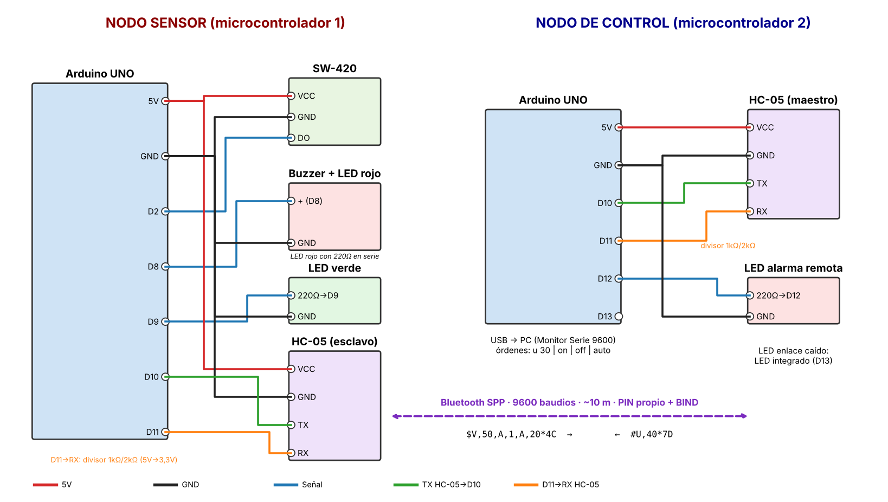

# EVA1 · Monitoreo de vibración con activación de alarma

Aplicaciones Móviles para IoT (TI3V42) · INACAP Apoquindo · P14

## 1. Integrantes y caso elegido

| Integrante | Rol |
|---|---|
| _Nombre Apellido 1_ | _completar_ |
| _Nombre Apellido 2_ | _completar_ |

**Caso:** Monitoreo de vibración con activación de alarma. Sistema de integridad estructural que identifica vibraciones anómalas en maquinaria o edificaciones y activa una alarma. Cumple las dos funciones comunes de la formativa:

- **Umbral de activación configurable** a distancia (en eventos de vibración por segundo).
- **Control manual remoto** de la alarma (encender, apagar, volver a automático).

**Algoritmo de diferenciación.** El nodo sensor cuenta los pulsos del SW-420 en ventanas de 1 s y clasifica cada ventana:

| Estado | Letra | Condición | Alarma |
|---|---|---|---|
| Normal | `N` | Intensidad bajo el umbral | Apagada |
| Transitoria | `T` | Supera el umbral, pero menos de 3 ventanas seguidas (golpe aislado, una puerta) | Apagada |
| Anómala | `A` | Supera el umbral 3 ventanas seguidas (vibración sostenida) | Encendida |
| Falla del sensor | `F` | Salida pegada en ALTO 3 s sin pulsos (cable cortado o módulo dañado) | Encendida (estado seguro) |

La alarma se apaga solo después de 3 ventanas tranquilas seguidas (histéresis), para que no se encienda y apague en el límite.

## 2. Tabla de componentes

| Componente | Voltaje | Interfaz o protocolo | Rango o alcance | Por qué sirve para el caso |
|---|---|---|---|---|
| Arduino UNO (ATmega328P) · nodo sensor | 5 V lógica, 7–12 V por jack | UART, GPIO, interrupción externa en pin 2 | 16 MHz, 14 pines digitales | Tiene interrupción externa para contar pulsos de vibración sin perder ninguno, y 5 V compatibles con el sensor y el buzzer. |
| Arduino UNO (ATmega328P) · nodo de control | 5 V | UART (USB al PC + SoftwareSerial al HC-05) | 16 MHz | Muestra las lecturas en el Monitor Serie y recibe las órdenes del operador por el mismo USB. |
| Sensor de vibración SW-420 (comparador LM393) | 3,3–5 V | Salida digital (DO) | Sensibilidad ajustable con potenciómetro; detecta vibración/golpe on-off | Entrega pulsos con cada vibración; contándolos por segundo se obtiene una intensidad que se compara con el umbral. Barato, robusto y sin calibración compleja. |
| Buzzer activo 5 V | 5 V, ~30 mA | Pin digital (HIGH = suena) | ~85 dB a 10 cm | Alarma sonora audible en una sala de máquinas; un pin basta para activarlo. |
| LED rojo + resistencia 220 Ω | 5 V (≈2 V en el LED, ~14 mA) | Pin digital | Visible a varios metros | Alarma visual en paralelo con el buzzer, útil en lugares ruidosos. |
| LED verde + 220 Ω (nodo sensor) | 5 V | Pin digital | — | Parpadea cada segundo: indica que el nodo está vivo. |
| Módulo Bluetooth HC-05 (×2) | 3,6–6 V alimentación, lógica 3,3 V | Bluetooth 2.0 SPP · UART 9600 baudios | ~10 m | Funciona como un cable serial invisible; uno queda como maestro y se enlaza solo con el esclavo. Alcance suficiente entre la máquina y la sala de control. |
| Divisor de voltaje 1 kΩ / 2 kΩ (×2) | 5 V → 3,3 V | — | — | Protege el RX del HC-05, que trabaja a 3,3 V. |
| LEDs pines 12 y 13 (nodo de control) | 5 V | Pin digital | — | 13: enlace caído. 12: repite la alarma remota en la sala de control. |

## 3. Diagrama de conexión



> Si el docente exige Tinkercad o Fritzing, armar el circuito ahí con estas mismas conexiones y reemplazar `diagrama.png`, o agregar una foto rotulada del montaje real.

**Nodo sensor**

| Pieza | Pin del componente | Pin del Arduino |
|---|---|---|
| SW-420 | VCC · GND · DO | 5V · GND · 2 |
| Alarma | Buzzer activo (+) y LED rojo (con 220 Ω) en paralelo | 8 |
| LED de vida | LED verde con 220 Ω | 9 |
| HC-05 (esclavo) | VCC · GND · TX · RX | 5V · GND · 10 · 11 por divisor 1k/2k |

**Nodo de control**

| Pieza | Pin del componente | Pin del Arduino |
|---|---|---|
| HC-05 (maestro) | VCC · GND · TX · RX | 5V · GND · 10 · 11 por divisor 1k/2k |
| LED alarma remota | LED con 220 Ω | 12 |
| LED enlace caído | LED integrado | 13 |

Emparejamiento: con el sketch `herramientas/configurar_hc05` (modo AT, 38400 baudios) se configura el maestro con `AT+ROLE=1`, `AT+CMODE=0`, `AT+BIND=<dirección del esclavo>` y en **ambos** módulos `AT+PSWD=<PIN nuevo>` (ver sección 5).

## 4. Formato del mensaje serial

Cada trama: carácter de inicio, contenido con campos separados por comas, `*`, checksum y fin de línea. El checksum es el XOR de todos los caracteres del contenido, en dos dígitos hexadecimales (como NMEA). 9600 baudios, 8N1.

- `$` = mensaje del nodo sensor → control
- `#` = comando del control → nodo sensor

**Lectura** `$V,<eventos>,<estado>,<alarma>,<modo>,<umbral>*CS`

| Campo | Unidad / valores |
|---|---|
| eventos | eventos de vibración por segundo (ev/s) |
| estado | `N` normal · `T` transitoria · `A` anómala · `F` falla del sensor |
| alarma | `1` encendida · `0` apagada |
| modo | `A` automático · `M` manual |
| umbral | umbral vigente en ev/s |

Ejemplo: `$V,50,A,1,A,20*4C` → 50 ev/s, vibración anómala, alarma encendida, modo automático, umbral 20 ev/s.

**Comandos**

| Trama | Significado | Respuesta |
|---|---|---|
| `#U,40*7D` | Cambia el umbral a 40 ev/s (rango 1–500) | `$OK,U40*79` |
| `#M,1*50` | Alarma manual encendida | `$OK,M1*54` |
| `#M,0*51` | Alarma manual apagada | `$OK,M0*55` |
| `#A*41` | Vuelve al modo automático | `$OK,A*69` |
| `#P*50` | Latido del control cada 2 s | (sin respuesta) |

Errores posibles: `$ER,FORMATO`, `$ER,CHECKSUM`, `$ER,RANGO`, `$ER,COMANDO`, `$ER,LARGO`, `$ER,SIN_ENLACE`.

En el Monitor Serie del nodo de control (9600, "Nueva línea") el operador escribe: `u 30`, `on`, `off`, `auto`.

## 5. Brechas de seguridad y medidas aplicadas

| # | Brecha del prototipo | Cómo se aprovecharía | Consecuencia en este caso | Medida aplicada | Dónde está en el código |
|---|---|---|---|---|---|
| 1 | PIN de emparejamiento por defecto del HC-05 (`1234`) | Alguien cerca con un celular se empareja con el nodo sensor | Puede apagar la alarma con `M,0` mientras una máquina vibra de forma peligrosa | Cambiar el PIN en ambos módulos con `AT+PSWD` y fijar el maestro a la dirección del esclavo con `AT+CMODE=0` + `AT+BIND` | `herramientas/configurar_hc05/configurar_hc05.ino` (pasos en el encabezado) |
| 2 | Comandos aceptados sin validar | Enviar `U,-500` o `U,99999` | Un umbral absurdo deja la alarma siempre encendida o nunca activa: la estructura queda sin vigilancia | Lista blanca de 5 comandos; el umbral se valida como entero entre 1 y 500; lo demás se rechaza sin ejecutar nada | `nodo_sensor.ino` → `procesarComando()` (bloques "1) Formato", "3) Rango" y `rechazar("COMANDO")`) |
| 3 | Mensajes sin control de integridad | Una interferencia (el motor que vibra genera ruido eléctrico) cambia un byte: `U,40` llega como `U,90` | El umbral sube sin que nadie lo pida y una vibración anómala no se detecta | Checksum XOR en cada trama; si no coincide se descarta | `nodo_sensor.ino` → `procesarComando()` bloque "2) Integridad"; `nodo_control.ino` → `procesarTrama()` |
| 4 | Mensajes demasiado largos | Enviar un texto enorme sin fin de línea | Desborda el arreglo `comando[24]`, corrompe la memoria y el nodo se cuelga: la alarma deja de funcionar | Largo máximo de 23 caracteres; si se pasa, se descarta entero | `nodo_sensor.ino` → `leerBluetooth()` bloque "4) Largo máximo" |
| 5 | Control manual sin vigilancia del enlace | Se corta el Bluetooth justo después de un `M,0` | La alarma queda forzada a apagada indefinidamente aunque la vibración sea peligrosa | Latido cada 2 s; si en 5 s no llega un mensaje válido, vuelve solo al modo automático | `nodo_sensor.ino` → `loop()` (`LIMITE_SIN_ENLACE`); `nodo_control.ino` → `loop()` (`enviarComando("P")`) |

**Registro de mensajes inválidos:** cada rechazo incrementa el contador `rechazados` y queda escrito en el Monitor Serie del nodo sensor como `[SEGURIDAD] Mensaje rechazado #n: motivo` (función `rechazar()`). Un mensaje inválido nunca ejecuta un comando: todas las validaciones hacen `return` antes de tocar el estado.

> Pruebas hechas: `U,-500` → `ER,RANGO`; `U,abc` → `ER,RANGO`; checksum alterado → `ER,CHECKSUM`; `RESET` → `ER,COMANDO`; texto de 40 caracteres → `ER,LARGO`. En ningún caso cambió el umbral ni la alarma.

## 6. Prácticas de la industria OT

| Práctica | Cómo se aplica | Por qué |
|---|---|---|
| **Protocolo con formato definido** (estilo NMEA / Modbus) | Inicio `$`/`#`, campos separados por comas con unidades documentadas, checksum y fin de línea | Cualquier equipo o la futura app Android (EVA2) puede interpretar la trama sin ambigüedad y detectar errores. |
| **Lecturas periódicas sin bloqueo** | `millis()` en ventanas de 1 s y conteo por interrupción; no hay `delay()` | El nodo nunca queda "sordo": atiende comandos mientras mide y no pierde pulsos de vibración. |
| **Modo automático y manual** (selector AUTO/MAN) | En `A` decide el algoritmo; en `M` decide el operador; `#A` vuelve a automático | Igual que en un tablero industrial: el operador puede intervenir (por ejemplo, silenciar durante una mantención) sin desactivar el sistema. |
| **Estado seguro ante fallas** (fail-safe) | Falla del sensor → alarma encendida (`F`). Enlace perdido en manual → vuelve a automático | En integridad estructural lo peligroso es no avisar; ante la duda, la alarma suena. |
| **Filtrado antes de actuar** | Confirmación en 3 ventanas + histéresis de 3 ventanas | Evita falsas alarmas por golpes aislados; las falsas alarmas repetidas hacen que los operadores ignoren la alarma real. |
| **ISA/IEC 62443 – mínimo privilegio** | El nodo sensor acepta solo 5 comandos (lista blanca) y rechaza el resto | La norma pide que cada equipo tenga solo los permisos que necesita. |
| **ISA/IEC 62443 – zonas y conductos** | El nodo sensor (zona de campo) solo se comunica con el nodo de control (zona de supervisión) por un único conducto: el enlace Bluetooth emparejado a una dirección fija con PIN propio | Limita quién puede hablar con el equipo de campo y por dónde. |
| **ISA/IEC 62443 – integridad y registro** | Checksum en cada trama y registro de mensajes rechazados | Se detectan datos alterados y queda evidencia de intentos inválidos. |

## Estructura de la entrega

```
eva1_vibracion/
├── nodo_sensor/nodo_sensor.ino        ← microcontrolador 1
├── nodo_control/nodo_control.ino      ← microcontrolador 2
├── herramientas/configurar_hc05/      ← cambiar PIN y BIND de los HC-05
├── diagrama.png
└── README.md
```

## Cómo probarlo

1. Cargar `nodo_sensor/nodo_sensor.ino` en el Arduino del sensor y `nodo_control/nodo_control.ino` en el de control.
2. Ajustar el potenciómetro del SW-420 para que en reposo no marque pulsos.
3. Abrir el Monitor Serie del control a 9600 baudios con "Nueva línea".
4. Golpear la mesa una vez → `TRANSITORIA`. Hacerla vibrar varios segundos → `ANOMALA` y suena la alarma.
5. Escribir `u 40`, `on`, `off`, `auto`, `u 900` y ver las confirmaciones o rechazos.
6. Desconectar el control en modo manual: a los 5 s el sensor vuelve a automático; el control muestra `SIN ENLACE CON EL NODO SENSOR`.
7. Desconectar el cable DO del SW-420: a los 3 s el estado pasa a `FALLA DEL SENSOR` y la alarma se enciende.
