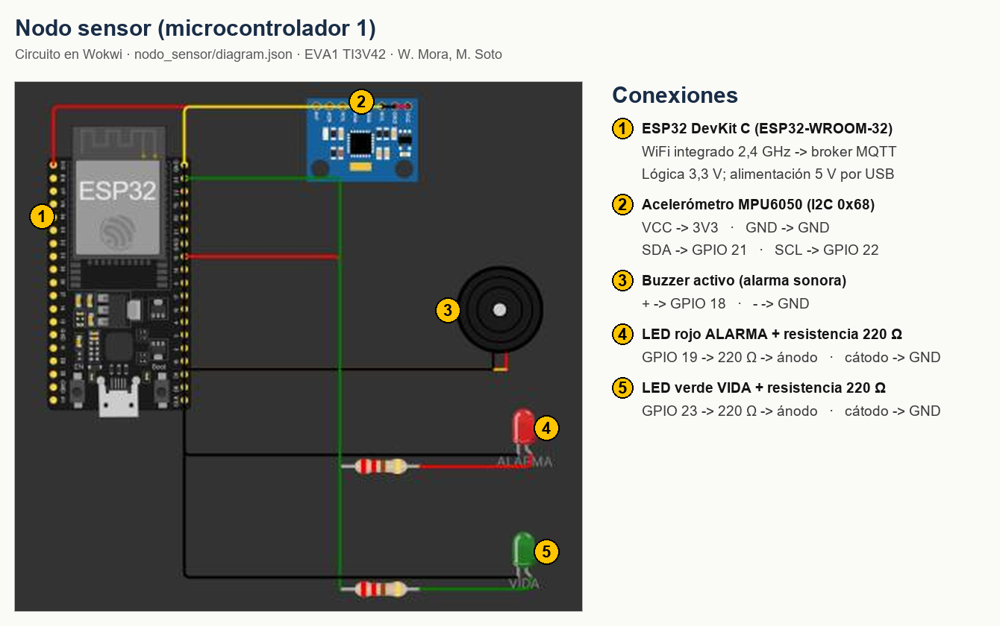
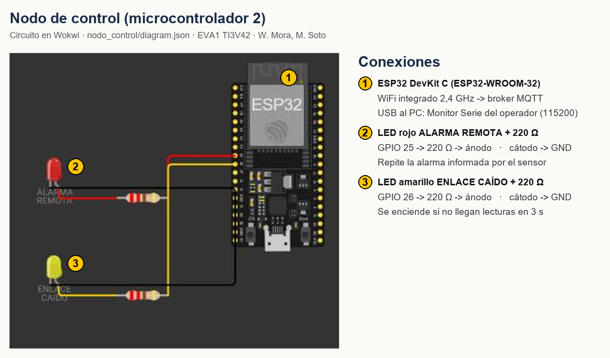

# EVA1 · Monitoreo de vibración con activación de alarma

Aplicaciones Móviles para IoT (TI3V42) · INACAP Apoquindo · P14

## 1. Integrantes y caso elegido

| Integrante | Rol |
|---|---|
| Walther Mora | Colaborador (estudiante) |
| Maximiliano Soto | Colaborador (estudiante) |

**Caso:** Monitoreo de vibración con activación de alarma. Es un sistema de integridad estructural que detecta vibraciones anómalas en maquinaria o edificaciones y activa una alarma. Cumple las dos funciones comunes que pide la formativa:

- **Umbral de activación configurable** a distancia, en mili-g (mg).
- **Control manual remoto** de la alarma: encender, apagar y volver a automático.

**Modalidad: simulación.** El prototipo se construye y prueba en el simulador **[Wokwi](https://wokwi.com)**, con dos ESP32 que se comunican **de forma inalámbrica por WiFi**. Se usa Wokwi porque Tinkercad no incluye placas ni módulos con radio (WiFi o Bluetooth): ahí los dos microcontroladores solo podrían unirse por cable, y la rúbrica pide comunicación inalámbrica. El código usa el mismo núcleo ESP32 de Arduino y está pensado para funcionar en dos ESP32 reales cambiando solo el nombre y la clave de la red WiFi; no se ha probado en hardware.

**Algoritmo de diferenciación.** El nodo sensor mide la aceleración 50 veces por segundo. En cada ventana de 1 s toma el **pico de desviación respecto de 1 g** (la gravedad), en mg, y clasifica la ventana:

| Estado | Letra | Condición | Alarma |
|---|---|---|---|
| Normal | `N` | Intensidad bajo el umbral | Apagada |
| Transitoria | `T` | Supera el umbral, pero menos de 3 ventanas seguidas (un golpe aislado, una puerta) | Apagada |
| Anómala | `A` | Supera el umbral 3 ventanas seguidas (vibración sostenida) | Encendida |
| Falla del sensor | `F` | El MPU6050 no responde durante 1 s completo (cable cortado o módulo dañado) | Encendida (estado seguro) |

La alarma se apaga solo después de 3 ventanas tranquilas seguidas (histéresis), para que no se encienda y apague en el límite.

## 2. Arquitectura

```
 NODO SENSOR (ESP32 #1)                                   NODO DE CONTROL (ESP32 #2)
 MPU6050 ─I2C─┐                                           ┌─ Monitor Serie (operador)
 Buzzer ──────┤ ESP32 ── WiFi ──► broker MQTT ◄── WiFi ── ESP32 ├─ LED alarma remota
 LED rojo ────┤        publica  .../datos  (lecturas)  ──►      └─ LED enlace caído
 LED verde ───┘        recibe   .../cmd    (comandos)  ◄──
```

Los dos ESP32 no se hablan por cable. Cada uno se conecta por WiFi a un **broker MQTT**, `broker.hivemq.com`, que reparte los mensajes. MQTT es el protocolo estándar de la industria IoT, y la Lectura de la Unidad 1 lo cita como estándar de IIoT (MQTT Sparkplug).

## 3. Tabla de componentes

| Componente | Voltaje | Interfaz o protocolo | Rango o alcance | Por qué sirve para el caso |
|---|---|---|---|---|
| **ESP32 DevKit C (ESP32-WROOM-32)** · nodo sensor | 3,3 V lógica; 5 V por USB | WiFi 802.11 b/g/n 2,4 GHz, I2C, GPIO | 240 MHz, 2 núcleos; WiFi ~50 m en interior | Trae WiFi integrado, así que no necesita un módulo de radio aparte. Tiene la velocidad para muestrear a 50 Hz, calcular la firma HMAC por hardware (mbedTLS) y atender la red sin perder muestras. |
| **ESP32 DevKit C (ESP32-WROOM-32)** · nodo de control | 3,3 V; 5 V por USB | WiFi 802.11 b/g/n, UART por USB al PC | WiFi ~50 m en interior | Recibe y muestra las lecturas en el Monitor Serie y envía las órdenes del operador por la misma red. |
| **Acelerómetro MPU6050** (GY-521) | 3,3 V (el módulo GY-521 acepta 3,3–5 V) | I2C, dirección 0x68, hasta 400 kHz | ±2 g (usado), configurable hasta ±16 g; 16 bits | Mide la aceleración en 3 ejes, así que entrega la **intensidad** de la vibración y no solo "hay/no hay" como un SW-420. Así el umbral es un número con unidades (mg) y el algoritmo distingue un golpe de una vibración sostenida. Es la opción "acelerómetro" que la guía propone para este caso. |
| **WiFi integrado del ESP32 + broker MQTT** (módulo inalámbrico) | 3,3 V (radio dentro del ESP32; ~240 mA en picos de transmisión) | WiFi 802.11 b/g/n 2,4 GHz; MQTT 3.1.1 sobre TCP, puerto 1883 | Lo que cubra la red WiFi; el broker está en Internet | Publicar y suscribir desacopla a los nodos y permite sumar la app Android (EVA2) como otro suscriptor sin tocar el sensor. |
| **Buzzer activo** | 3,3–5 V, ~30 mA | Pin digital GPIO 18 (HIGH = suena) | ~85 dB a 10 cm | Alarma sonora audible en una sala de máquinas. Con un buzzer de 5 V real se usa un transistor (2N2222) porque el GPIO entrega 3,3 V y hasta ~40 mA. |
| **LED rojo + resistencia 220 Ω** | 3,3 V (≈2 V en el LED, ~6 mA) | Pin digital GPIO 19 | Visible a varios metros | Alarma visual junto al buzzer; sirve en lugares ruidosos. |
| **LED verde + 220 Ω** (nodo sensor) | 3,3 V | Pin digital GPIO 23 | — | Parpadea cada segundo: indica que el nodo está vivo. |
| **LED rojo + 220 Ω** (nodo de control) | 3,3 V | Pin digital GPIO 25 | — | Repite en la sala de control la alarma del sensor. |
| **LED amarillo + 220 Ω** (nodo de control) | 3,3 V | Pin digital GPIO 26 | — | Se enciende si dejan de llegar lecturas: enlace caído. |

## 4. Diagrama de conexión

Hecho en Wokwi (simulador aceptado por el docente). Las capturas están rotuladas con números que remiten a la lista de conexiones. Los archivos `nodo_sensor/diagram.json` y `nodo_control/diagram.json` contienen el circuito completo y se pueden abrir en Wokwi.





**Nodo sensor**

| Pieza | Pin del componente | Pin del ESP32 |
|---|---|---|
| MPU6050 | VCC · GND · SDA · SCL | 3V3 · GND · 21 · 22 |
| Buzzer activo | + · − | 18 · GND |
| LED rojo (alarma) | ánodo por 220 Ω · cátodo | 19 · GND |
| LED verde (vida) | ánodo por 220 Ω · cátodo | 23 · GND |

**Nodo de control**

| Pieza | Pin del componente | Pin del ESP32 |
|---|---|---|
| LED rojo (alarma remota) | ánodo por 220 Ω · cátodo | 25 · GND |
| LED amarillo (enlace caído) | ánodo por 220 Ω · cátodo | 26 · GND |

## 5. Formato del mensaje serial

Cada mensaje es una línea de texto con un carácter de inicio, el contenido con campos separados por comas, un checksum y una firma:

```
<inicio><contenido>*<CS>;<FIRMA>
```

- `$` = mensaje del nodo sensor al control (tópico `inacap/ti3v42/vib-wm-ms/datos`).
- `#` = comando del control al sensor (tópico `inacap/ti3v42/vib-wm-ms/cmd`).
- `CS` = XOR de todos los caracteres del contenido, en 2 dígitos hexadecimales, como en NMEA. Detecta bytes alterados.
- `FIRMA` = primeros 4 bytes del HMAC-SHA256 de `<inicio><contenido>`, con una clave que solo conocen los dos nodos, en 8 dígitos hexadecimales. Prueba que el mensaje viene de un nodo legítimo.

**Lectura** (una por segundo): `$V,<intensidad>,<estado>,<alarma>,<modo>,<umbral>,<seq>*CS;FIRMA`

| Campo | Unidad / valores |
|---|---|
| intensidad | pico de desviación respecto de 1 g en la última ventana de 1 s, en **mg**; `-1` si el sensor falló |
| estado | `N` normal · `T` transitoria · `A` anómala · `F` falla del sensor |
| alarma | `1` encendida · `0` apagada |
| modo | `A` automático · `M` manual |
| umbral | umbral vigente, en **mg** |
| seq | número del último comando aceptado (permite que el control retome la secuencia) |

Ejemplo de lectura: `$V,412,A,1,A,300,57*61;eef8c861` → 412 mg, vibración anómala, alarma encendida, modo automático, umbral 300 mg, último comando aceptado n.º 57.

**Comandos:** `#<seq>,<orden>*CS;FIRMA`. Cada comando lleva un número de secuencia mayor que el anterior.

| Ejemplo de trama | Significado | Respuesta del sensor |
|---|---|---|
| `#58,U,400*6C;2ec68e41` | Cambia el umbral a 400 mg (rango 50–4000) | `$OK,U400*49;fa081f9b` |
| `#59,M,1*70;fe0f3cde` | Alarma manual encendida | `$OK,M1*54;c43f5787` |
| `#60,M,0*7B;daa820f2` | Alarma manual apagada | `$OK,M0*55;5c971881` |
| `#61,A*6A;ee0bb481` | Vuelve al modo automático | `$OK,A*69;698b7b59` |
| `#62,P*78;68b1e910` | Latido del control, cada 2 s | (sin respuesta) |

Respuestas de error: `$ER,FORMATO`, `$ER,CHECKSUM`, `$ER,FIRMA`, `$ER,REPETIDO`, `$ER,RANGO`, `$ER,COMANDO`, `$ER,LARGO` y `$ER,SIN_ENLACE`. Si el sensor se desconecta del broker, este publica en su nombre `$ER,OFFLINE` (la "última voluntad" de MQTT).

En el Monitor Serie del nodo de control (115200 baudios, "Nueva línea") el operador escribe `u 400`, `on`, `off` o `auto`, y el nodo arma la trama.

## 6. Brechas de seguridad y medidas aplicadas

| # | Brecha del prototipo | Cómo se aprovecharía | Consecuencia en este caso | Medida aplicada | Dónde está en el código |
|---|---|---|---|---|---|
| 1 | **Broker MQTT público y abierto**: cualquiera puede publicar en el tópico de comandos | Un atacante que conoce el tópico publica `#…,M,0` desde su computador | Apaga la alarma mientras una máquina vibra peligrosamente | Cada mensaje lleva una **firma HMAC-SHA256** con clave compartida; si la firma no calza, se rechaza sin ejecutar nada | `nodo_sensor.ino` → `firmar()` y `procesarComando()` bloque "3) Autenticidad"; `nodo_control.ino` → `procesarTrama()` |
| 2 | **Repetición de comandos** (replay) | El atacante copia un comando legítimo y firmado (`M,0`) y lo vuelve a publicar más tarde | Repite el apagado de la alarma aunque no conozca la clave | **Número de secuencia**: el sensor solo acepta un número mayor que el último aceptado | `nodo_sensor.ino` → `procesarComando()` bloque "4) Secuencia" (`ultimoSeq`) |
| 3 | **Comandos sin validar** | Enviar `U,-500`, `U,99999` o `U,abc` | Con un umbral absurdo, la alarma queda siempre encendida o nunca se activa: la estructura queda sin vigilancia | **Lista blanca** de 5 comandos; el umbral se valida como entero entre 50 y 4000 mg; todo lo demás se rechaza | `nodo_sensor.ino` → `procesarComando()` bloque "5) Rango" y `rechazar("COMANDO")` |
| 4 | **Mensajes alterados en el camino** | Un error de transmisión cambia un byte: `U,400` llega como `U,900` | El umbral sube sin que nadie lo pida y una vibración anómala no se detecta | **Checksum XOR** en cada trama; si no coincide, se descarta | `nodo_sensor.ino` → `procesarComando()` bloque "2) Integridad"; `nodo_control.ino` → `procesarTrama()` |
| 5 | **Mensajes demasiado largos** | Publicar un texto enorme en el tópico | Desborda el arreglo de recepción, corrompe la memoria y el nodo se cuelga: la alarma deja de funcionar | **Largo máximo** de 63 caracteres; lo que no cabe se descarta entero | `nodo_sensor.ino` → `alRecibir()` bloque "6) Largo máximo" |
| 6 | **Control manual sin vigilancia del enlace** | Se corta el WiFi justo después de un `M,0` | La alarma queda forzada a apagada indefinidamente aunque la vibración sea peligrosa | Latido firmado cada 2 s; si en 5 s no llega un mensaje auténtico, el sensor **vuelve solo al modo automático** | `nodo_sensor.ino` → `loop()` (`LIMITE_SIN_ENLACE`); `nodo_control.ino` → `loop()` (`enviarComando("P")`) |

**Registro de mensajes inválidos:** cada rechazo incrementa el contador `rechazados`, queda escrito en el Monitor Serie del sensor como `[SEGURIDAD] Mensaje rechazado #n: motivo` (función `rechazar()`) y se avisa al control con `$ER,<motivo>`. Un mensaje inválido nunca ejecuta un comando: cada validación hace `return` antes de tocar el estado.

**Riesgos que quedan y cómo se cerrarían en un sistema real:**
- La conexión al broker usa el puerto 1883, sin TLS. Cualquiera puede **leer** las lecturas, aunque no falsificarlas. Se cerraría con TLS (puerto 8883) y un broker privado con usuario, clave y permisos por tópico.
- La clave HMAC está escrita en el firmware. Si alguien extrae el código del chip, la obtiene. Se cerraría guardándola en memoria cifrada (eFuse o flash encryption del ESP32).
- La firma usa 4 bytes del HMAC para que la trama sea corta. En producción se usaría completa.
- Si el sensor se reinicia, su contador de secuencia vuelve a 0 y aceptaría un comando antiguo repetido hasta recibir el siguiente legítimo, que llega en menos de 2 s con el latido.

## 7. Prácticas de la industria OT

| Práctica | Cómo se aplica | Por qué |
|---|---|---|
| **Protocolo con formato definido** (estilo NMEA / Modbus) | Inicio `$`/`#`, campos con unidades documentadas, checksum y fin de línea | Cualquier equipo, o la futura app Android (EVA2), puede interpretar la trama sin ambigüedad y detectar errores. |
| **Lecturas periódicas sin bloqueo** | `millis()` para muestrear a 50 Hz y cerrar ventanas de 1 s; no hay `delay()`; la reconexión MQTT se intenta cada 5 s sin detener el programa | El nodo nunca queda "sordo": atiende comandos mientras mide. |
| **Modo automático y manual** (selector AUTO/MAN) | En `A` decide el algoritmo; en `M` decide el operador; `auto` vuelve a automático | Igual que en un tablero industrial: el operador puede intervenir (por ejemplo, silenciar durante una mantención) sin desactivar el sistema. |
| **Estado seguro ante fallas** (fail-safe) | Sensor sin respuesta → alarma encendida (`F`). Enlace perdido en manual → vuelve a automático | En integridad estructural lo peligroso es no avisar; ante la duda, la alarma suena. |
| **Control local independiente de la red** | El algoritmo y la alarma corren en el nodo sensor aunque no haya WiFi ni broker | La red supervisa, pero la seguridad de la máquina no depende de ella. |
| **Filtrado antes de actuar** | Confirmación en 3 ventanas e histéresis de 3 ventanas | Evita falsas alarmas por golpes aislados. Las falsas alarmas repetidas hacen que los operadores ignoren la alarma real. |
| **ISA/IEC 62443 · mínimo privilegio** | El sensor acepta solo 5 comandos (lista blanca) y rechaza el resto | La norma pide que cada equipo tenga solo los permisos que necesita. |
| **ISA/IEC 62443 · zonas y conductos** | El sensor (zona de campo) y el control (zona de supervisión) se comunican solo por dos tópicos propios; cada nodo escucha únicamente el tópico que le corresponde | Limita por dónde se puede hablar con el equipo de campo. |
| **ISA/IEC 62443 · autenticación e integridad** | Firma HMAC, checksum, número de secuencia y registro de mensajes rechazados | Se detectan datos alterados o falsificados y queda evidencia de los intentos. |

## 8. Cómo probarlo en Wokwi

Se necesitan **dos ventanas** del navegador (no dos pestañas de la misma ventana), una por nodo, visibles a la vez lado a lado: Wokwi frena hasta ~3 % la simulación de una pestaña que no está a la vista.

1. Abrir <https://wokwi.com/projects/new/esp32>.
2. En `sketch.ino` pegar `nodo_sensor/nodo_sensor.ino`. En `diagram.json` pegar `nodo_sensor/diagram.json`.
3. En **Library Manager** → `+` agregar **PubSubClient**.
4. Repetir los pasos 1 a 3 en **otra ventana** con `nodo_control/`, y poner las dos ventanas lado a lado.
5. Presionar ▶ en ambas. Esperar "Conectando a MQTT... listo".
6. En el control debe aparecer `Vibracion: 0 mg (umbral 300) | Estado: NORMAL ...` cada segundo.
7. En el sensor, hacer clic en el MPU6050 y subir **accel X** a 1 g durante 1 a 2 s y volver a 0 → `TRANSITORIA`. Dejarlo en 1 g más de 3 s → `ANOMALA`, y se encienden el LED rojo y el buzzer.
8. En el Monitor Serie del control escribir `u 500`, `on`, `off`, `auto` y `u 9000`, y ver las confirmaciones o el rechazo.
9. Poner el control en `off` y detener su simulación: a los 5 s el sensor vuelve solo a `AUTO`. Al reanudar, el control muestra el enlace recuperado.
10. **Falla del sensor:** detener el sensor, reemplazar su `diagram.json` por `herramientas/diagram_sin_mpu.json` (el mismo circuito sin el MPU6050) y volver a presionar ▶. El sensor debe mostrar `MPU6050 no responde` y publicar `$V,-1,F,1,A,...`, con el LED rojo y el buzzer encendidos; en el control debe aparecer `Vibracion: --` y `Estado: FALLA DEL SENSOR`. Al terminar, volver a pegar `nodo_sensor/diagram.json`.

**Prueba de seguridad automatizada:** con el nodo sensor corriendo, ejecutar

```
python herramientas/probar_seguridad.py
```

El script hace de atacante: envía un comando válido y luego uno repetido, uno con checksum alterado, uno con firma falsa, umbrales inválidos, un comando fuera de la lista blanca y un mensaje gigante. Muestra si cada uno fue aceptado o rechazado.

## 9. Pruebas realizadas

Pruebas P1 a P15 hechas el 21-10-2026 en Wokwi. Cada nodo corrió en el simulador y su contraparte la hizo un script de Python conectado al mismo broker (`herramientas/probar_seguridad.py` y dos scripts auxiliares de prueba). Así se pudo atacar cada nodo con mensajes falsos que el otro nodo nunca enviaría. P16 y P17 se hicieron el 22-10-2026 con los dos nodos corriendo juntos en Wokwi.

| ID | Caso | Resultado esperado | Resultado obtenido |
|---|---|---|---|
| P1 | Compilación de ambos sketches | Sin errores | ✅ Ambos compilan en Wokwi y con `arduino-cli` 1.5 (el motor de compilación de Arduino IDE) para **ESP32 Dev Module**, núcleo esp32 3.3.12 y PubSubClient 2.8: sin errores ni advertencias con `--warnings all`. Uso de memoria: sensor 70 % de flash y 14 % de RAM; control 70 % y 14 % |
| P2 | Lecturas llegan al control | Una lectura por segundo, interpretada | ✅ `Vibracion: 0 mg (umbral 300) \| Estado: NORMAL \| Alarma: apagada \| Modo: AUTO` |
| P3 | Golpe aislado (accel X = 1 g por ~1 s) | `TRANSITORIA`, alarma apagada | ✅ `$V,414,T,0,A,300,…` y luego vuelve a `N` |
| P4 | Vibración sostenida (accel X = 1 g por 7 s) | `ANOMALA`, alarma encendida | ✅ `T`, `T` y luego `$V,414,A,1,A,300,…`; al soltar, 2 ventanas en `A` (histéresis) y vuelve a `N` |
| P5 | `u 500` desde el control | `OK,U500` y el umbral cambia | ✅ `El sensor confirmo: U500`; las lecturas pasan a `umbral 500` |
| P6 | `on` / `auto` desde el control | `OK,M1` / `OK,A` | ✅ Ambos confirmados; con `on` la lectura muestra alarma `1` y modo `M` |
| P7 | Umbral inválido (`U,-500` y `U,abc`) | `ER,RANGO`, el umbral no cambia | ✅ `$ER,RANGO` en ambos casos |
| P8 | Comando repetido (replay) | `ER,REPETIDO` | ✅ `$ER,REPETIDO` |
| P9 | Firma falsa (atacante sin la clave) | `ER,FIRMA` | ✅ `$ER,FIRMA`; en el control: `[SEGURIDAD] Firma invalida, trama descartada` |
| P10 | Checksum alterado | `ER,CHECKSUM` | ✅ `$ER,CHECKSUM`; en el control: `[SEGURIDAD] Checksum incorrecto, trama descartada` |
| P11 | Mensaje de 100 caracteres | `ER,LARGO` | ✅ `$ER,LARGO` |
| P12 | Comando fuera de la lista blanca (`RESET`) | `ER,COMANDO` | ✅ `$ER,COMANDO` |
| P13 | Se cortan los latidos con el sensor en manual | El sensor vuelve a `AUTO` a los 5 s | ✅ A los ~5 s: `$ER,SIN_ENLACE` y las lecturas pasan de modo `M` a `A` |
| P14 | El sensor deja de publicar | El control avisa enlace caído | ✅ `SIN ENLACE CON EL NODO SENSOR` en el Monitor Serie (el código además enciende el LED amarillo, GPIO 26; no se revisó visualmente) |
| P15 | Orden desconocida en el control (`xyz`) | Muestra la ayuda, no envía nada | ✅ `Ordenes: u 400 \| on \| off \| auto` |
| P16 | Falla del sensor: se arranca el sensor con `herramientas/diagram_sin_mpu.json` (sin MPU6050) | `F` con la alarma encendida (estado seguro) | ✅ Prueba del 22-10-2026 con los dos nodos en Wokwi: el sensor muestra `MPU6050 no responde` y publica `$V,-1,F,1,A,…` con LED rojo y buzzer encendidos; el control muestra `Estado: FALLA DEL SENSOR \| Alarma: ENCENDIDA` |
| P17 | Ensayo de punta a punta: los dos nodos en Wokwi a la vez, en dos ventanas lado a lado, por el broker MQTT | Lecturas, comandos, rechazo y pérdida de enlace funcionan entre los dos nodos sin scripts de por medio | ✅ Prueba del 22-10-2026 siguiendo la sección 8: lecturas cada segundo en el control; golpe → `TRANSITORIA`; vibración sostenida → `ANOMALA` con LED rojo y buzzer; `u 500`, `on`, `off` y `auto` confirmados; `u 9000` rechazado con `RANGO`; al detener el control en manual, el sensor vuelve a `AUTO` a los ~5 s; al detener el sensor, el control muestra `SIN ENLACE CON EL NODO SENSOR` con el LED amarillo |

**Estado `F`:** Wokwi no permite desconectar el MPU6050 con la simulación corriendo, así que la falla se probó arrancando el sensor con el circuito sin MPU6050 (P16).

**Lo que mostraron las pruebas:** la primera versión tomaba la hora (`ahora = millis()`) antes de atender la red. Si en ese momento llegaba un mensaje, la resta sin signo `ahora - ultimoContacto` se daba vuelta: el control marcaba "SIN ENLACE" en cada lectura y el sensor salía de manual al instante. Se corrigió tomando la hora después de `mantenerRed()` en ambos `loop()`.

**Observación de red:** durante una prueba, la simulación perdió el broker y los reintentos fallaron (estado MQTT `-2`). Mientras tanto, el nodo sensor siguió midiendo y decidiendo la alarma de forma local, que es el comportamiento esperado (control local independiente de la red). Al reiniciar, la conexión se recuperó. Cada intento de reconexión MQTT (uno cada 5 s) puede detener el programa unos instantes mientras espera al broker; en esa prueba las lecturas siguieron saliendo una por segundo.

## Estructura de la entrega

```
EVA1_Vibracion/
├── nodo_sensor/
│   ├── nodo_sensor.ino      ← microcontrolador 1
│   └── diagram.json         ← circuito Wokwi
├── nodo_control/
│   ├── nodo_control.ino     ← microcontrolador 2
│   └── diagram.json         ← circuito Wokwi
├── herramientas/
│   ├── probar_seguridad.py  ← pruebas de seguridad por MQTT
│   └── diagram_sin_mpu.json ← circuito del sensor sin MPU6050, para probar la falla
├── diagrama_sensor.png      ← captura rotulada del circuito del sensor
├── diagrama_control.png     ← captura rotulada del circuito del control
└── README.md
```

**Para compilar en Arduino IDE:**
1. *Archivo → Preferencias → Gestor de URLs adicionales de tarjetas*: agregar `https://espressif.github.io/arduino-esp32/package_esp32_index.json`.
2. *Herramientas → Placa → Gestor de tarjetas*: instalar **esp32** de Espressif (probado con la 3.3.12).
3. *Programa → Incluir librería → Gestionar bibliotecas*: instalar **PubSubClient** de Nick O'Leary (probado con la 2.8).
4. Elegir la placa **ESP32 Dev Module**, abrir `nodo_sensor/nodo_sensor.ino` o `nodo_control/nodo_control.ino` y presionar **Verificar**.
